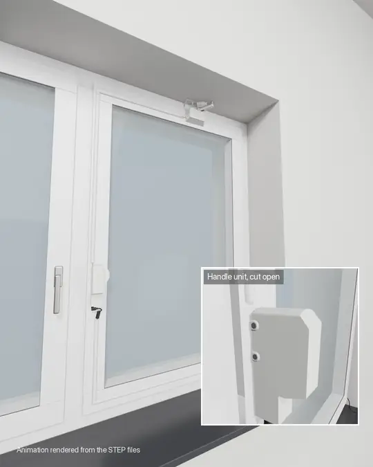
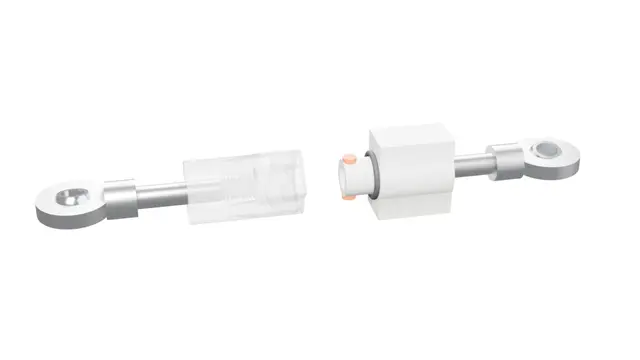

# ESPHome Tilt Window Opener

    
    
    

Motorise an ordinary **tilt-and-turn window** (German: *Dreh-Kipp-Fenster*) with two
3D-printed units, two 12 V servos (DSSERVO DS51150, 150 kg·cm) and an ESP8266 running [ESPHome](https://esphome.io).
The window shows up in Home Assistant as a `cover` and can be tilted open and closed
again, including turning the handle. No drilling: the handle unit uses the original
handle screws and the top unit is hot-glued.

  
   
  Rendered animation. The inset shows the handle unit cut open, then the linkage at the top of the sash.
  <a href="docs/media/demo.mp4">Full resolution video</a>

> **Status: v0.1.** The hardware and firmware have been in daily use for more than a year.
> Places that still need a value are marked **TBD**; values marked *(estimate)* were derived from
> the CAD files and still need to be confirmed.

## Features

- Tilts the window open and closes it again from Home Assistant (`cover` entity, device class `window`)
- Turns the handle by itself: closed ↔ tilt, plus a "fully open" (turn) position
- Servo power is switched by a relay only while something moves: no humming or holding current when idle
- Maintenance mode to calibrate every end position from Home Assistant; values are stored on the device
- Bayonet quick release in the linkage, so the window can still be opened completely by hand
- Hot glue on the top unit doubles as a breakaway point if something jams
- Firmware can be flashed from the browser (ESP Web Tools) and adopted in the ESPHome dashboard

## How it works

The opener consists of two units on the sash, connected by a servo cable:

| | Handle unit | Top unit |
|---|---|---|
| Replaces / sits on | the window handle | the top rail of the sash |
| Servo | DS51150, 150 kg·cm, 12 V, **270° version** | DS51150, 150 kg·cm, 12 V, 180° or 270° version |
| Moves | the 7 mm square spindle of the window gear | an 80 mm arm, linked to a pivot glued into the corner between frame and lintel |
| Also contains | the [PCB](pcb/README.md) (Wemos D1 mini, relay, 5 V step-down converter) | – |

The original handle is removed. A short 7 mm square spindle goes from the window gear into
the **ServoHornAdapter**, which is screwed onto the servo horn on the same axis, so the servo
turns the spindle directly, like a hand on the handle. The handle servo is the 270° version of the DS51150:
the handle only needs 180°, the rest is margin for adjusting the end positions in software.

At the top, the servo arm and a short coupler with two rod ends (uniball joints) form a linkage
to a fixed pivot. When the arm swings round, it pushes the top of the sash into the room, and the
window tilts. The coupler is a printed bayonet, so the window can be disconnected from the arm
and opened completely by hand.

Sequence (see [`window-actuator-template-esp8266.yaml`](window-actuator-template-esp8266.yaml)):

| Open | Close |
|---|---|
| 1. Relay on (servo power) | 1. Relay on |
| 2. Handle servo → tilt position (3 s) | 2. Arm servo → closed position (2 s) |
| 3. Arm servo → open position (2 s) | 3. Handle servo → closed position (3 s) |
| 4. Relay off | 4. Relay off |

## What you need

### Window

A standard tilt-and-turn window with the usual handle fixing: two screws 43 mm apart and a
7 mm square spindle; handle down = closed, horizontal = turn, up = tilt. The top unit needs a
bit of visible frame between the top of the sash and the lintel for the arm and the pivot mount.

### Printed parts

All parts are in [`print-files/`](print-files) as STEP and (mostly) 3MF.

| Part | Folder | Qty | Notes |
|---|---|---|---|
| Base | `Handle` | 1 | Mounts with the original handle screws. 3MF: **TBD** |
| Case | `Handle` | 1 | Holds the handle servo and the PCB holder |
| ServoCover | `Handle` | 1 | Snaps onto the two CoverSnaps |
| CoverSnap | `Handle` | 2 | Clamped under the servo screws |
| PCBHolder | `Handle` | 1 | Slides into the slot at the edge of the base. 3MF: **TBD** |
| ServoHornAdapter | `Handle` | 1 | Square spindle → servo horn |
| ServoCoverMount | `Movement` | 1 | Housing for the arm servo, hooks over the top rail of the sash |
| NutHolder | `Movement` | 2 | Holds the M3 nuts behind the servo flange |
| ServoArm | `Movement` | 1 | 80 mm from servo axis to the M6 bolt |
| TopPivotMount *or* TopPivotMountChamfered | `Movement` | 1 | Pivot in the corner between frame and lintel. Use the chamfered version (45°) if that corner is not a clean right angle |
| BayonetSocket + BayonetPlug | `Movement` | 1 each | Quick release between the two rod ends. Both have a printed M6 thread for the rod ends |
| CableDuctCorner | `Accessories` | 2 | Corner for 16 × 8 mm half-round cable duct; the spigots go into the duct ends. One per bend, see [wiring](docs/assembly.md#6-wiring) |

The 3MF files contain only the geometry, no printer or slicer settings.

- **Material:** PLA is enough, even on a window in the sun.
- **Settings** *(estimate)*: 0.2 mm layers, 4 walls, 30–40 % infill for the parts that carry the
  servo torque (Base, Case, ServoHornAdapter, ServoArm, ServoCoverMount, bayonet), 20 % for the rest.
- Supports only where the slicer finds real overhangs; keep nut traps and slots free of support.

### Electronics

| Qty | Part | Notes |
|---|---|---|
| 2 | Servo **DSSERVO DS51150** (150 kg·cm, 12 V), e.g. [this one on AliExpress](https://www.aliexpress.com/item/1005006896077837.html) | 270° version for the handle; for the arm 180° is enough. The 12 V supply is why the 150 kg version is used: the smaller ones are specified below 12 V. The servo horn that comes with it is used |
| 1 | Custom PCB, 35 × 60 mm, with a Wemos D1 mini, a 5 V relay for the servo power and a 12 V → 5 V step-down converter | Gerbers, design files and parts list in [`pcb/`](pcb/README.md) |
| 1 | 12 V power supply, 5 A, standard plug 5.5 × 2.1 mm, centre positive | The prototype runs on a 12 V / 5 A supply. An angled plug fits best under the case |
| 1 | Servo extension cable | From the handle unit to the top unit (top centre of the sash); length depends on the window |
| – | Cable duct, half-round, 16 × 8 mm | Along the sash for both cables, see [wiring](docs/assembly.md#6-wiring). The prototype uses white D-Line duct with the printed CableDuctCorner at the bends |

### Hardware

| Qty | Part | Where |
|---|---|---|
| 1 | 7 mm square spindle, 50 mm on the prototype; the length depends on the window, see [below](#spindle-length) | Window gear → ServoHornAdapter |
| 2 | Original handle screws | Base → sash |
| 3 | M4×16 countersunk | Case → Base (from the side) |
| 3 | M4 square nut, DIN 562 (7 × 7 × 2.2 mm) | Slots in the base |
| 8 | M3×25 | 4 per servo: handle servo and CoverSnaps → Case, arm servo → ServoCoverMount |
| 8 | Rubber grommets, come with the servos | In the flange slots of both servos, to decouple vibrations |
| 8 | M3 nut | 4 in the case, 2 in each NutHolder |
| 4 | M3×10 countersunk | Servo horns (2 on the adapter, 2 on the arm) |
| 1 | M3×10 | PCB → PCBHolder |
| 2 | M6 rod end / uniball joint with male thread (e.g. SA6T/K or POSA6) | Screwed into the bayonet socket and plug |
| 1 | M6×25 + M6 nut | Rod end → ServoArm |
| 1 | M4×16 + M4 washer + M4 nut | Rod end → pin of the TopPivotMount |
| 1 | O-ring 10 × 2 mm | On the stem of the bayonet plug, keeps the bayonet locked |
| – | Hot glue | ServoCoverMount → sash, TopPivotMount → frame and lintel |

The servo horns are the ones that come with the DS51150 servos.

#### Spindle length

The spindle has to stick out about **21–25 mm from the surface of the sash** (where the handle
rosette was) *(estimate)*: the square hole in the ServoHornAdapter starts about 13 mm above the sash
and is 12.8 mm deep. These values come from the CAD files, a model of the DS51150 and the measured
7.5 mm between case and CoverSnap (rubber grommets under the servo flange), not from a measurement
of the spindle itself. How far the spindle goes into the window depends on the window. The prototype uses a
50 mm spindle; a longer one can be cut to length.

## Assembly

See the step-by-step guide in **[docs/assembly.md](docs/assembly.md)**.

## Firmware

### Install

1. Open the [installer page](https://malte-d.github.io/esphome-tilt-window-opener/) in Chrome or Edge,
   connect the D1 mini via USB and click **Install**.
2. Enter your Wi-Fi credentials in the installer (Improv). Alternatively, the device opens a
   fallback hotspot `window-actuator-xxxxxx`; its password is set in the YAML (`wifi.ap.password`).
3. Home Assistant discovers the device. To customise the firmware, adopt it in the ESPHome dashboard,
   which imports [`window-actuator-template-esp8266.yaml`](window-actuator-template-esp8266.yaml).

### Pins

| D1 mini pin | Function |
|---|---|
| D1 (GPIO5) | Arm servo signal (`servo_movement`) |
| D3 (GPIO0) | Handle servo signal (`servo_handle`) |
| D2 (GPIO4) | Relay that switches the 12 V servo supply |

### Entities

| Entity | Type | Purpose |
|---|---|---|
| Window | cover | Open (tilt) / close |
| Maintenance Mode | switch | Blocks open/close and enables the manual buttons below |
| Servo Handle Close / Open / Fully Open Position | number | Handle servo positions for closed, tilt and turn (−100 … 100) |
| Servo Movement Open / Close Position | number | Arm servo positions (−100 … 100) |
| manual_handle_close / _open / _fully_open | button | Move the handle servo (maintenance mode only) |
| manual_movement_open / _close | button | Move the arm servo (maintenance mode only) |
| relay_on / relay_off | button | Switch the servo supply (maintenance mode only) |
| home | button | Mark the window as closed without moving anything, e.g. after it was closed by hand |

The value range −100 … 100 covers the full servo travel (pulse 0.5–2.5 ms).
Defaults: handle closed `65`, tilt `-72`, turn `0`; arm open `68`, closed `-100`.

### Calibration

1. Turn on **Maintenance Mode**. The number entities now show the stored positions.
2. Press **relay_on** to power the servos.
3. Handle: set *Servo Handle Close Position* and press **manual_handle_close**. Adjust until the
   handle is exactly in the closed position. Repeat for *Open* (tilt, **manual_handle_open**) and
   *Fully Open* (turn, **manual_handle_fully_open**).
4. Turn the handle to **tilt** first, then set the arm with *Servo Movement Close/Open Position*
   and **manual_movement_close / _open**.
5. Press **relay_off** and turn Maintenance Mode off. Positions survive reboots.

> ⚠️ Only move the arm while the handle is in the tilt position. With the handle closed, the arm
> pushes against the locked sash with full servo force.

### Opening the window by hand

To open the window completely, e.g. for cleaning:

1. Maintenance Mode on, **relay_on**, **manual_handle_fully_open**: the handle is now in the turn position.
2. Release the bayonet coupler at the top: push the two halves together, turn back, pull apart.
3. Open the window by hand.

  
   
  The bayonet coupler, socket drawn transparent. <a href="docs/media/bayonet.mp4">Video</a>

To go back, close the window, press **manual_handle_close**, reconnect the coupler, press
**relay_off**, turn Maintenance Mode off and press **home** if Home Assistant shows the wrong state.

## Safety

- The servos are strong (DS51150, 150 kg·cm). Keep fingers away from the arm, the coupler and the handle
  unit while the servos are powered.
- The hot-glued top unit is meant to break off before the window or the frame gets damaged.
  Check it from time to time.
- An open window lets in rain and is an easy way into the house. Use automations accordingly,
  e.g. close the window when it starts to rain or when nobody is home.

## Renders and animation

The pictures in `docs/` and the demo animation are rendered from the STEP files with Blender.
The scripts live in [`tools/render/`](tools/render/README.md), so everything can be re-rendered
once parts change.

## License

**TBD**
