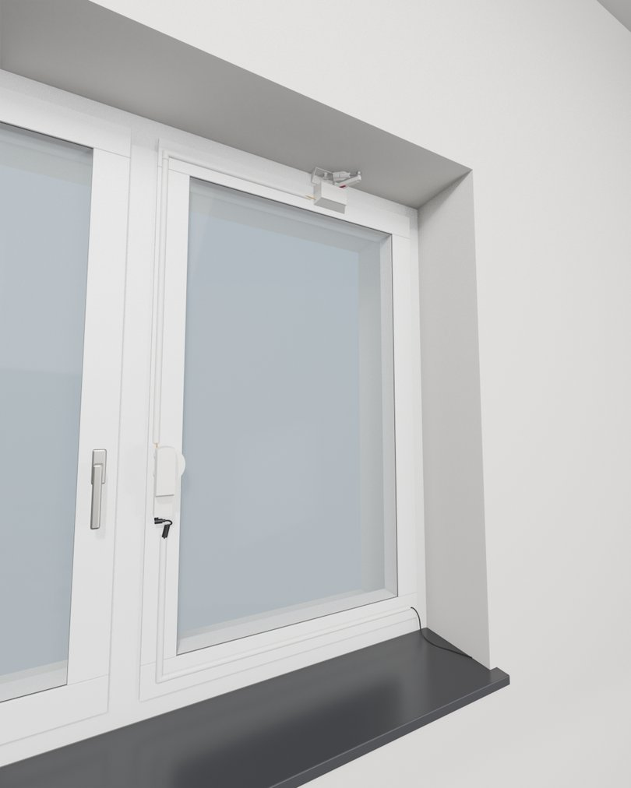
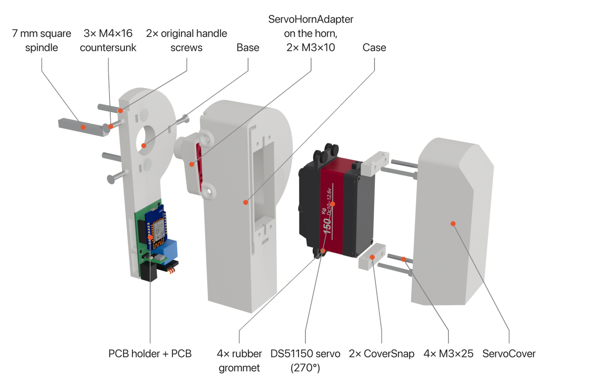
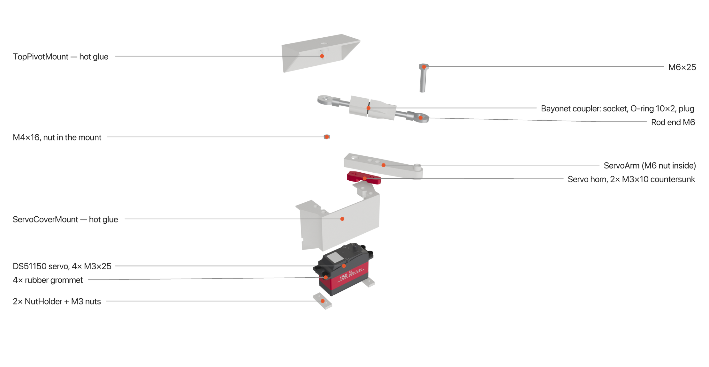
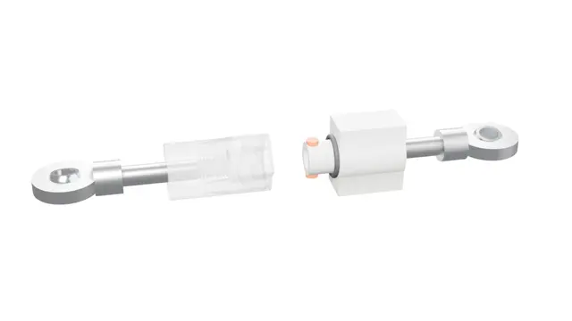
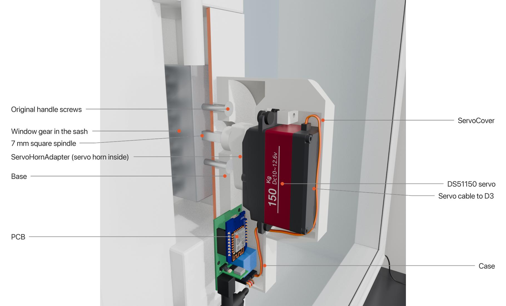
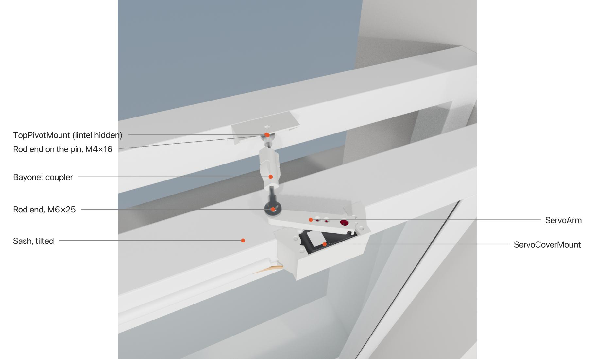
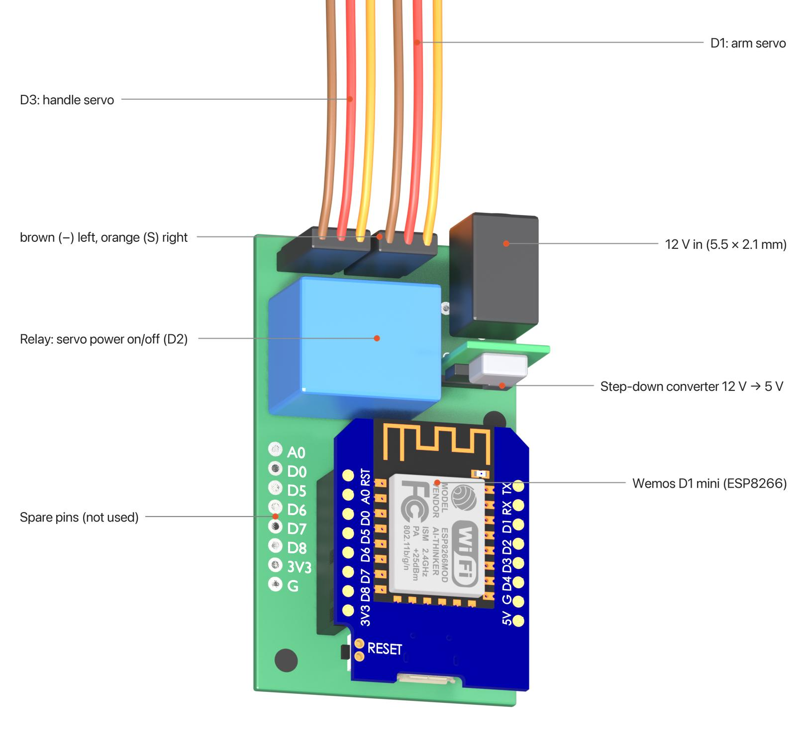
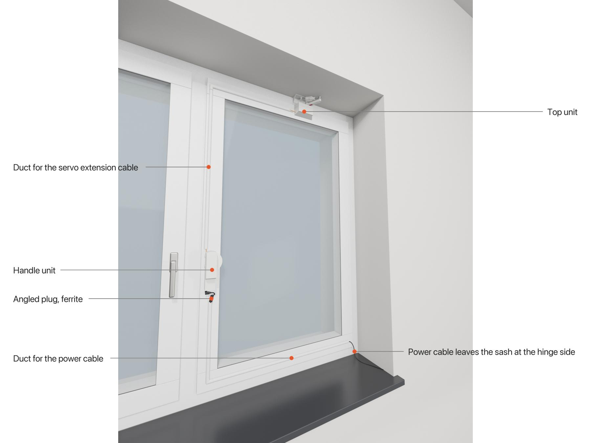

# Assembly guide

This guide walks through building and installing both units. Parts and screws are listed in the
[README](../README.md#what-you-need). Values that are still missing are marked **TBD**, estimated values
are marked *(estimate)*.

**Tools:** screwdrivers / hex keys for M3, M4 and M6, pliers to hold nuts, hot glue gun, USB cable for flashing.

**Overview**

1. [Print the parts](#1-print-the-parts)
2. [Flash the firmware](#2-flash-the-firmware)
3. [Build the handle unit](#3-build-the-handle-unit)
4. [Build the top unit](#4-build-the-top-unit)
5. [Install on the window](#5-install-on-the-window)
6. [Wiring](#6-wiring)
7. [Calibrate and test](#7-calibrate-and-test)

---

## 1. Print the parts

Print every part from [`print-files/`](../print-files) once, except **CoverSnap**, **NutHolder** and
**CableDuctCorner** (2× each).
For the top pivot, choose **TopPivotMount** or **TopPivotMountChamfered**. The chamfered version (45°)
fits corners between frame and lintel that are not a clean right angle (plaster, silicone).

Material and settings: see the [README](../README.md#printed-parts). PLA is enough.

Before you start, clean the nut traps and slots so that the nuts drop in easily:

| Part | Nuts |
|---|---|
| Base | 3× M4 square nut in the slots next to the side holes |
| Case | 4× M3 nut in the traps around the servo opening (inside) |
| NutHolder | 2× M3 nut each |
| ServoArm | 1× M6 nut in the hex pocket at the end of the arm (horn side) |
| TopPivotMount | 1× M4 nut in the hex pocket on the back |

## 2. Flash the firmware

Flash the PCB / D1 mini first, as described in the [README](../README.md#install). You need a working
device to bring the servos into a defined position before the horns are mounted.

The PCB, its parts list and the Gerber files are described in [`pcb/`](../pcb/README.md).

## 3. Build the handle unit

### 3.1 Servo into the case

1. Put the four M3 nuts into the traps inside the **Case**.
2. Insert the handle servo (DS51150, 270° version) from the front of the case, **output shaft towards the window**.
   The servo body sticks out of the case; the ServoCover goes over it later.
3. Push the **rubber grommets** that come with the servo into the four slots of the servo flange.
   They sit between flange and case and decouple the servo's vibrations; with them the CoverSnaps
   end up about 7.5 mm above the case.
4. Put one **CoverSnap** on each servo flange, with the snap ridge facing outwards.
5. Screw everything together with **4× M3×25** through CoverSnap, grommets, servo flange and case
   wall into the nuts. Do not squash the grommets flat.

### 3.2 Horn and ServoHornAdapter

1. Connect the servo to the PCB (header **D3**) and power it up. In Home Assistant, turn on
   **Maintenance Mode**, press **relay_on**, then **manual_handle_close**. The servo is now in the
   *closed* position.
2. Put the servo horn (the one that comes with the servo) on the shaft so that the
   **ServoHornAdapter** will point **downwards** (towards the PCB, like a closed handle), and tighten
   the horn's centre screw.
3. Place the ServoHornAdapter over the horn (the horn sits in the pocket on the back of the adapter)
   and fix it with **2× M3×10 countersunk** through the adapter into the horn. The shape of the
   pocket shows which holes of the horn are used.

The servo axis sits exactly in the centre of the rounded top end of the case. The adapter turns with
the spindle like the handle would: *down* (closed), *horizontal* (turn), *up* (tilt). The angle
does not need to be perfect: the end positions are fine-tuned in step 7.

### 3.3 PCB holder

Screw the PCB onto the **PCBHolder** (1× M3×10) and slide the holder into the slot at the edge of the **Base**.

## 4. Build the top unit

### 4.1 Servo into the ServoCoverMount

1. Put two M3 nuts into each **NutHolder**.
2. Slide the arm servo (DS51150) into the **ServoCoverMount** from the open back (the side that will face the sash),
   output shaft pointing **up** through the opening.
3. Push the **rubber grommets** that come with the servo into the four flange slots, place the
   NutHolders under the two servo flanges and screw the servo in from above with **4× M3×25**
   through the counterbored holes (the same screws as on the handle servo). The grommets mainly
   decouple the servo's vibrations from the window; they also hold the thin M3 screws in the
   middle of the large flange holes.

### 4.2 Arm

1. Connect the servo to header **D1** on the PCB, turn on Maintenance Mode and press **relay_on**,
   then **manual_movement_close**.
2. Mount the servo horn and tighten its centre screw.
3. Put the M6 nut into the hex pocket of the **ServoArm**, then fix the arm on the horn with
   **2× M3×10 countersunk**. The large hole in the arm gives access to the horn's centre screw.

In the closed position the arm should point **almost straight into the room** (nearly 90° to the
window). That leaves some room for adjustment, and at the end of the closing movement the arm moves
the sash slowly and with the most force.

### 4.3 Linkage

1. Attach the first rod end to the end of the arm with **M6×25** (into the M6 nut in the arm).
2. Put the M4 nut into the hex pocket on the back of the **TopPivotMount**, slide the second rod end
   onto its pin and secure it with **M4×16** and a washer under the screw head.
3. Screw the **BayonetSocket** onto one rod end and the **BayonetPlug** onto the other. Both have a
   printed M6 thread.
4. Slide the **O-ring 10×2** over the stem of the plug, up to the shoulder.
5. Connect the bayonet: push the plug into the socket with its two lugs in the entry slots, turn it
   by about 50° and let go. The O-ring pushes the lugs into the notch at the end of the slots, so the
   bayonet cannot turn open by itself.
   The threads do not turn while you do this: each half turns the housing of its rod end, and the
   balls of the two rod ends stay on their bolts. Together they just cover the turn, each swinging
   from one stop to the other.

The length of the coupler is set with the threads: screw the rod ends further in or out until the
linkage fits your window. There is no fixed value.

The bayonet is also the quick release: open it to disconnect the window from the arm and open the
window by hand (see [README](../README.md#opening-the-window-by-hand)).

## 5. Install on the window

### 5.1 Handle unit

1. Close the window. Turn the cover of the handle rosette by 90° to uncover the two screws, unscrew them
   and pull the handle off. **Keep the screws**, they are reused.
2. Push the **7 mm square spindle** into the window gear. It has to stick out about **21–25 mm**
   from the sash *(estimate)*, see [spindle length](../README.md#spindle-length).
3. Screw the **Base** onto the sash with the original handle screws. The spindle comes out through the
   large hole in the middle.
4. Check that the three M4 square nuts are in the base.
5. Put the **Case** over the base: the ServoHornAdapter slides onto the spindle. If it does not fit,
   do not force it. Turn the horn on the servo spline by one tooth, or adjust the closed position.
6. Fix the case with **3× M4×16 countersunk** from the sides (two on the narrow side, one in the round part).
7. Connect the cables (see [Wiring](#6-wiring)) and snap the **ServoCover** onto the two CoverSnaps.

### 5.2 Top unit

The **ServoCoverMount** hooks over the top rail of the sash with its small lip; the open back sits flat
against the sash. The **TopPivotMount** goes into the corner between the window frame and the lintel.

1. Clean all gluing surfaces (the sash, frame and lintel must be free of dust and grease).
2. Turn the handle to tilt (Maintenance Mode, **manual_handle_open**), and check the travel by hand
   before gluing: with the window closed, the arm in the closed position and the linkage connected,
   hold both mounts in place, then tilt the window a few times and check that nothing collides.
3. Hot-glue the **ServoCoverMount** to the sash and the **TopPivotMount** into the corner.

Hot glue holds well (it survived a full summer on the prototype) and also acts as a **breakaway point**:
if something jams, the glue gives way before the window or the frame gets damaged.

## 6. Wiring

| Connector on the PCB | Connect |
|---|---|
| **D3** | Handle servo |
| **D1** | Arm servo, via the servo extension cable |
| DC jack | 12 V power supply (5.5 × 2.1 mm, centre positive) |

Both servo headers are marked **− + S** on the board: brown wire to −, red to +, orange (signal) to S.
The relay on the PCB switches the 12 V for the servos and is only on while the window moves.

Both cables run in half-round cable duct on the room side of the sash (the prototype uses white
D-Line duct, 16 × 8 mm). At the two bends a printed **CableDuctCorner** joins the pieces: cut the
duct square and push the spigots of the corner into the ends.

- **Servo extension cable (D1):** inside the case it leaves the PCB through the opening next to the
  DC jack, runs in the small channel under the ServoCover and comes out at the top of the handle
  unit on the window side. From there the duct goes up the stile and along the top rail to the top unit.
- **Power cable:** an angled 5.5 × 2.1 mm plug goes into the jack at the bottom of the case. The
  cable makes a small loop and runs in a duct down the stile and along the bottom rail to the
  **hinge side**, where it leaves the sash and goes to the power supply. Leaving the sash near the
  hinges matters: that is where the sash moves least, so the window can still be tilted and opened.

## 7. Calibrate and test

1. Follow the [calibration steps](../README.md#calibration) in the README: handle positions first,
   then the arm positions **with the handle in tilt position**.
2. Turn Maintenance Mode off and press **home** so that Home Assistant knows the window is closed.
3. Open and close the window a few times from Home Assistant and watch the whole movement.
   The handle must reach the tilt position before the arm moves, and the window must be fully closed
   before the handle turns back.

> ⚠️ Never move the arm while the handle is in the closed position: the servo then pushes against the
> locked sash with full force.
