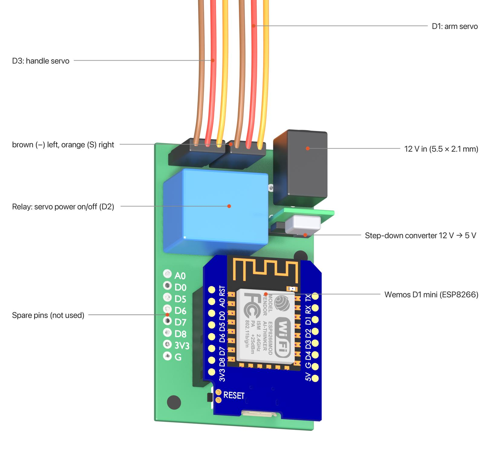

# PCB

A small two-layer board (35 × 60 mm, 1.6 mm) that carries the Wemos D1 mini, switches the servo
power and connects both servos. It sits on the PCBHolder in the handle unit (1× M3×10).

## Files

| File | What it is |
|---|---|
| [`gerber/window-opener-v26-gerber.zip`](gerber/window-opener-v26-gerber.zip) | Gerber and drill files, revision v26, the board in use (ordered from JLCPCB in 2024). Upload this zip to any PCB manufacturer |
| [`window-opener.sch`](window-opener.sch), [`window-opener.brd`](window-opener.brd) | Schematic and board, EAGLE 9.7 format. Open them in Fusion Electronics or EAGLE, or import them into KiCad |

The design files are newer than the Gerbers: they add two optional 0 Ω bridges (R3, R4) on the
bottom of the board, which the v26 board does not have. What they are for: **TBD**.

## Circuit

- **12 V in:** DC jack 5.5 × 2.1 mm, centre positive.
- **5 V:** a small step-down converter makes 5 V from the 12 V for the D1 mini and the relay coil.
  It is a 3-pin module that fits the TO-220 footprint of a 7805 (IN, GND, OUT), e.g.
  [this one on AliExpress](https://www.aliexpress.com/item/1005006579355456.html). The board files show an LM7805 there as a placeholder. A real
  LM7805 would also work, but it turns the 7 V difference into heat inside the closed case.
- **Servo power:** D2 switches the relay through an N-channel MOSFET (100 Ω gate resistor,
  10 kΩ pull-down). The relay connects the 12 V to the + pin of both servo headers, so the
  servos only get power while the window moves.
- **Servo signals:** D3 → handle servo (JP1), D1 → arm servo (JP2).
- **Spare pins:** JP3 brings out A0, D0, D5–D8, 3V3 and GND. They are not used by the firmware.

## Connectors

| Header | Silkscreen | Connect | Pin order |
|---|---|---|---|
| JP1 | D3 | Handle servo | − + S (brown, red, orange) |
| JP2 | D1 | Arm servo (via the extension cable) | − + S (brown, red, orange) |
| 12V | – | 12 V power supply, 5 A | centre positive |

## Parts

| Ref | Qty | Part | Package |
|---|---|---|---|
| WEMOS2 | 1 | Wemos D1 mini (ESP8266), with its two 8-pin headers | module |
| U$1 | 1 | Relay SRD-05VDC-SL-C (5 V coil, 10 A contacts) | THT |
| IC1 | 1 | Step-down converter module 12 V → 5 V, pin-compatible with a 7805, e.g. [this one](https://www.aliexpress.com/item/1005006579355456.html). Pin order on the board, left to right as printed: 5V, GND, 12V; check the IN/OUT marks on the module | 3 pins, 2.54 mm, upright |
| 12V | 1 | DC jack 5.5 × 2.1 mm, Würth 694106301002 | THT |
| Q1 | 1 | N-channel MOSFET, logic level (type used: **TBD**, e.g. AO3400A) | SOT-23 (G-S-D) |
| R1 | 1 | 100 Ω | 0805 |
| R2 | 1 | 10 kΩ | 0805 |
| JP1, JP2 | 2 | Pin header 1×3, 2.54 mm | THT |
| JP3 | 1 | Pin header 1×8, 2.54 mm (optional) | THT |

The three SMD parts are large enough (0805, SOT-23) to solder by hand.
